# AI-DLC Adaptive Workflow Overview

**Purpose**: Technical reference for AI model and developers to understand complete workflow structure.

**Note**: Similar content exists in welcome-message.md (user welcome message) and README.md (documentation). This duplication is INTENTIONAL - each file serves a different purpose:
- **This file**: Detailed technical reference with Mermaid diagram for AI model context loading
- **welcome-message.md**: User-facing welcome message with ASCII diagram
- **README.md**: Human-readable documentation for repository

## The Three-Phase Lifecycle:
• **INCEPTION PHASE**: Workspace Detection, Reverse Engineering (brownfield), composite Vision / Tech Env / catalog / scopes, Requirements Analysis, User Stories, Workflow Planning, Application Design, Units Generation
• **CONSTRUCTION PHASE**: Per-unit design, Design Validation, Code Generation, Build and Test
• **OPERATIONS PHASE**: Rules Validation, Deployment (opt-in first), Post-Deployment Testing, Docusaurus Export

## The Adaptive Workflow:
• **Workspace Detection** (always) → **Reverse Engineering** (brownfield; gate `reverse_engineering`) → **Create Vision, Tech Env, Features and Scopes** (always; gate `vision_scope`) → **Requirements Analysis** (always) → **User Stories** (conditional) → **Workflow Planning** (always) → **Application Design** (conditional) → **Units Generation** (when stories exist) → gate `inception_end` → per-unit Construction → gate `build_and_test` → Operations → Docusaurus Export → gate `operations`

## How It Works:
• **AI analyzes** your request, workspace, and complexity to determine which stages are needed
• **These stages always execute**: Workspace Detection; Create Vision / Tech Env / catalog / scopes; Requirements Analysis; Workflow Planning; Design Validation; Code Generation (per-unit); Build and Test; Docusaurus Export
• **Named gates stop the run.** Other Inception and Construction stages have **no stage gate** — they continue. Do not wait for "Approve & Continue" except at a named gate.
• **Conditional stages**: Reverse Engineering, User Stories, Application Design, Units Generation (skip only when User Stories also skipped), per-unit design stages, Rules Validation, Deployment, Post-Deployment Testing

## Named gates (wait)

| Gate | When |
| ---- | ---- |
| `reverse_engineering` | After Reverse Engineering (brownfield) |
| `vision_scope` | After Vision, Tech Env, catalog, scopes |
| Extension opt-in | Blocking question at Requirements Analysis |
| `inception_end` | After Inception, before Construction |
| `design_validation` | Per unit, when hybrid/human triggers fire (or mode is `human`) |
| `build_and_test` | Door into Operations |
| v1-operations checkpoints | Rules Validation, Deployment, PDT when those stages **run** |
| Deployment opt-in | When the deployment extension is not active; asked **before** infrastructure-design artifacts |
| `operations` | After Docusaurus export |

## Your Team's Role:
• **Answer blocking questions** in dedicated question files using [Answer]: tags
• **Non-blocking questions** go to the question file **and** `aidlc-docs/assumptions.md`; do not wait for "done"
• **Approve named gates** (written to a file and presented in the assistant turn)
• **Collectively decide** on architectural approach when a gate asks

## AI-DLC Three-Phase Workflow:

```mermaid
flowchart TD
    Start(["User Request"])

    subgraph INCEPTION["INCEPTION PHASE"]
        WD["Workspace Detection ALWAYS"]
        RE["Reverse Engineering COND"]
        GRE["gate reverse_engineering"]
        VIS["Vision TechEnv catalog scopes ALWAYS"]
        GVS["gate vision_scope"]
        RA["Requirements Analysis ALWAYS"]
        Stories["User Stories COND"]
        WP["Workflow Planning ALWAYS"]
        AppDesign["Application Design COND"]
        UnitsG["Units Generation when stories"]
        GIE["gate inception_end"]
    end

    subgraph CONSTRUCTION["CONSTRUCTION PHASE"]
        FD["Functional Design COND"]
        NFRA["NFR Requirements COND"]
        NFRD["NFR Design COND"]
        ID["Infrastructure Design COND"]
        GDV["gate design_validation"]
        CG["Code Generation ALWAYS"]
        BT["Build and Test ALWAYS"]
        GBT["gate build_and_test"]
    end

    subgraph OPERATIONS["OPERATIONS PHASE"]
        RV["Rules Validation COND"]
        DEP["Deployment opt-in first"]
        PDT["Post-Deployment Testing COND"]
        EXP["Docusaurus Export ALWAYS"]
        GOPS["gate operations"]
    end

    Start --> WD
    WD -.-> RE
    WD --> VIS
    RE --> GRE
    GRE --> VIS
    VIS --> GVS
    GVS --> RA
    RA -.-> Stories
    RA --> WP
    Stories --> WP
    WP -.-> AppDesign
    WP -.-> UnitsG
    AppDesign -.-> UnitsG
    WP --> GIE
    AppDesign --> GIE
    UnitsG --> GIE
    GIE --> FD
    FD -.-> NFRA
    NFRA -.-> NFRD
    NFRD -.-> ID
    FD --> GDV
    NFRA --> GDV
    NFRD --> GDV
    ID --> GDV
    GDV --> CG
    CG -.->|Next Unit| FD
    CG --> BT
    BT --> GBT
    GBT -.-> RV
    GBT --> EXP
    RV -.-> DEP
    RV --> EXP
    DEP -.-> PDT
    DEP --> EXP
    PDT --> EXP
    EXP --> GOPS
    GOPS --> End(["Complete"])

    style WD fill:#4CAF50,stroke:#1B5E20,stroke-width:3px,color:#fff
    style VIS fill:#4CAF50,stroke:#1B5E20,stroke-width:3px,color:#fff
    style RA fill:#4CAF50,stroke:#1B5E20,stroke-width:3px,color:#fff
    style WP fill:#4CAF50,stroke:#1B5E20,stroke-width:3px,color:#fff
    style CG fill:#4CAF50,stroke:#1B5E20,stroke-width:3px,color:#fff
    style BT fill:#4CAF50,stroke:#1B5E20,stroke-width:3px,color:#fff
    style EXP fill:#4CAF50,stroke:#1B5E20,stroke-width:3px,color:#fff
    style GRE fill:#EF5350,stroke:#B71C1C,stroke-width:3px,color:#fff
    style GVS fill:#EF5350,stroke:#B71C1C,stroke-width:3px,color:#fff
    style GIE fill:#EF5350,stroke:#B71C1C,stroke-width:3px,color:#fff
    style GDV fill:#EF5350,stroke:#B71C1C,stroke-width:3px,color:#fff
    style GBT fill:#EF5350,stroke:#B71C1C,stroke-width:3px,color:#fff
    style GOPS fill:#EF5350,stroke:#B71C1C,stroke-width:3px,color:#fff
    style RE fill:#FFA726,stroke:#E65100,stroke-width:3px,stroke-dasharray: 5 5,color:#000
    style Stories fill:#FFA726,stroke:#E65100,stroke-width:3px,stroke-dasharray: 5 5,color:#000
    style AppDesign fill:#FFA726,stroke:#E65100,stroke-width:3px,stroke-dasharray: 5 5,color:#000
    style UnitsG fill:#FFA726,stroke:#E65100,stroke-width:3px,stroke-dasharray: 5 5,color:#000
    style FD fill:#FFA726,stroke:#E65100,stroke-width:3px,stroke-dasharray: 5 5,color:#000
    style NFRA fill:#FFA726,stroke:#E65100,stroke-width:3px,stroke-dasharray: 5 5,color:#000
    style NFRD fill:#FFA726,stroke:#E65100,stroke-width:3px,stroke-dasharray: 5 5,color:#000
    style ID fill:#FFA726,stroke:#E65100,stroke-width:3px,stroke-dasharray: 5 5,color:#000
    style RV fill:#FFA726,stroke:#E65100,stroke-width:3px,stroke-dasharray: 5 5,color:#000
    style DEP fill:#FFA726,stroke:#E65100,stroke-width:3px,stroke-dasharray: 5 5,color:#000
    style PDT fill:#FFA726,stroke:#E65100,stroke-width:3px,stroke-dasharray: 5 5,color:#000
    style INCEPTION fill:#BBDEFB,stroke:#1565C0,stroke-width:3px, color:#000
    style CONSTRUCTION fill:#C8E6C9,stroke:#2E7D32,stroke-width:3px, color:#000
    style OPERATIONS fill:#FFF59D,stroke:#F57F17,stroke-width:3px, color:#000
    style Start fill:#CE93D8,stroke:#6A1B9A,stroke-width:3px,color:#000
    style End fill:#CE93D8,stroke:#6A1B9A,stroke-width:3px,color:#000

    linkStyle default stroke:#333,stroke-width:2px
```

**Stage Descriptions:**

**INCEPTION PHASE** - Planning and Architecture
- Workspace Detection: Analyze workspace state and project type (ALWAYS)
- Reverse Engineering: Analyze existing codebase (CONDITIONAL - Brownfield only); gate `reverse_engineering`
- Create Vision, Tech Env, Features and Scopes: composite (ALWAYS); gate `vision_scope`
- Requirements Analysis: Gather and validate requirements (ALWAYS - Adaptive depth). No stage gate. Extension opt-in is blocking.
- User Stories: Create user stories and personas (CONDITIONAL; runs **before** Workflow Planning)
- Workflow Planning: Create execution plan (ALWAYS). No stage gate; override at `inception_end`
- Application Design: High-level component identification (CONDITIONAL). No stage gate.
- Units Generation: At least one UNIT when stories exist (DAG + story map). No stage gate.
- Gate `inception_end`: human review of the Inception package

**CONSTRUCTION PHASE** - Design, Implementation, Build and Test
- Functional Design / NFR Requirements / NFR Design / Infrastructure Design: CONDITIONAL, per-unit, no stage gate
- Design Validation: ALWAYS per unit. Gate `design_validation` when hybrid triggers fire (including `public_contract`) or mode is `human`
- Code Generation: ALWAYS, per-unit. No stage gate.
- Build and Test: ALWAYS. Gate `build_and_test`

**OPERATIONS PHASE** - Validation, Deployment, and Documentation
- Rules Validation: CONDITIONAL — at least one extension opted IN. Skip if none opted IN. OVERRIDE applies only when the stage runs.
- Deployment: opt-in/skip question **first**; Construction infrastructure artifacts only if proceeding
- Post-Deployment Testing: CONDITIONAL — skipped when Deployment was SKIPPED
- Docusaurus Export: ALWAYS. Generate the scaffold **in the product repo** `docs-site/`. Gate `operations`

**Key Principles:**
- Named gates stop. Other stages continue.
- INCEPTION focuses on "what" and "why"
- CONSTRUCTION focuses on "how" plus "build and test"
- OPERATIONS validates, optionally deploys, and publishes docs
- Simple changes may skip conditional INCEPTION stages
- Complex changes get full INCEPTION and CONSTRUCTION treatment
