# Plano de produto: AI-DLC v1 autônomo

**Versão do plano:** v2 (10 de novembro de 2026, 21:48 America/Sao_Paulo)  
**Repositório:** [github.com/tiagoaltomare/aidlc-workflows](https://github.com/tiagoaltomare/aidlc-workflows) (fork de `awslabs/aidlc-workflows`)  
**Natureza:** plano de produto, não de implementação em código.

Este plano descreve a customização do AI-DLC v1 no fork: um fluxo autônomo com Vision e Tech Env como passo fixo, escopos incrementais, gates humanos concentrados no fim de cada fase (com os gates de segurança que a v1 e a `v1-operations` já tinham em RE, Build & Test e Operations) e um Operations que reaproveita Rules Validation, Deployment e Post-Deployment Testing, mais o export Docusaurus como documentação oficial do produto.

### O que mudou nesta v2

- Decisões do Tiago incorporadas no corpo do plano (não só na seção 9): branch a partir de `origin/v1`; `design_validation.mode` default `hybrid`; Vision e Tech Env em `aidlc-docs/vision/`; regras novas em inglês; idioma do Docusaurus configurável em `operations.docs.language`; Operations reaproveita a branch `v1-operations` junto com o export.
- Nas demais perguntas, entram defaults conservadores e coerentes com o fluxo, cada um marcado como **default proposto pelo PM, Tiago pode mudar**.
- O merge de `origin/v1-operations` passa a ser uma fase de implementação com critério de aceite (F1).

## Fontes inspecionadas (somente leitura)

Nenhuma branch, PR ou commit foi criado neste trabalho. O clone em `/workspace/aidlc-analysis` não foi alterado além deste arquivo de plano, que permanece fora do versionamento até o Tiago decidir commitá-lo.

| Ref | SHA | Papel nesta v2 |
| --- | --- | --- |
| `origin/v1` | `9fd17f197` (30/09/2026, 15:38 America/Sao_Paulo) | **Base da branch.** AI-DLC 1.0.1, com Operations ainda placeholder. |
| `origin/v1-operations` | `98b8c08ca` (30/09/2026, 09:50 America/Sao_Paulo) | **Fonte do merge na F1.** Rules Validation, Deployment, Post-Deployment Testing e as extensions operacionais. Sem release oficial. |
| `origin/main` | `5f27495a5` (22/10/2026, 09:18 America/Sao_Paulo) | Linha do AI-DLC Workflows 2.0. Não é a base. Registrada só como alternativa na seção 8. |
| `feature/memoria-ciclos` | `979da0ebb` | Trabalho de memória entre ciclos, **descartado** como base desta versão. |

Skills atuais de Vision e Tech Env, usadas apenas como base (não como o step novo):

- Pacotes do portal: `/workspace/aidlc/raw/portal/downloads/vision-document-guide/` e `technical-environment-guide/`.
- Cópias iguais em projetos: `/workspace/ais-base/.grok/skills/vision-document-guide` e `technical-environment-guide`.
- Não foram encontradas em `/home/box/agent-data/workflows`.
- Guias oficiais da v1: `docs/writing-inputs/vision-document-guide.md`, `technical-environment-guide.md` e `inputs-quickstart.md`.

Na v1, Vision e Tech Env **não são estágios**. São entradas recomendadas (`vision-document.md` e `technical-environment.md` na raiz do projeto) antes de o fluxo começar. Torná-los um step fixo é customização do fork. Os artefatos versionados ficam em `aidlc-docs/vision/` (decisão do Tiago).

---

## 1. Objetivo

Transformar o AI-DLC v1, no fork, num fluxo mais autônomo, cravado nas regras (não numa skill avulsa), em que a IA gera os artefatos e o humano entra em poucos pontos de controle — e, no Operations, nos checkpoints de segurança que já existem na `v1-operations`.

O ciclo passa a:

1. Garantir Vision e Tech Env completos em `aidlc-docs/vision/` (reuso se já existirem; geração completa em greenfield; geração a partir do codebase em brownfield, com catálogo de features).
2. Quebrar o Vision em escopos incrementais, cada um com lista do que está dentro e do que está fora.
3. Pedir revisão humana desse pacote (`vision_scope`).
4. Rodar a Inception de forma autônoma, sem gate fase a fase, até um único gate no fim (`inception_end`), onde ainda é possível mudar tudo.
5. Rodar a Construction de forma autônoma por unidade: design, validação do design (default `hybrid`), construção, próxima unidade; no fim, Build & Test, com gate humano antes de entrar no Operations.
6. Rodar o Operations reaproveitado da `v1-operations` (Rules Validation, Deployment, Post-Deployment Testing), exportar a documentação oficial em Docusaurus no repo do produto, e fechar o ciclo no gate `operations`.

O trabalho de memória entre ciclos (`feature/memoria-ciclos`) não entra nesta versão. A continuidade entre ciclos fica no Vision versionado, nos escopos e na marcação das features entregues — não numa wiki nem num acúmulo de contexto.

---

## 2. Novo fluxo

### 2.1 O que muda em relação à v1.0.1

Na v1 oficial (`aidlc-rules/aws-aidlc-rules/core-workflow.md` e `common/process-overview.md`):

- A Inception começa em Workspace Detection e, em brownfield, no Reverse Engineering. Em seguida vêm Requirements, Stories, Workflow Planning, Application Design e Units Generation, **cada um com gate humano** (Stories e Units têm dois: plano e geração).
- A Construction tem loop por unidade (Functional Design, NFR Requirements, NFR Design, Infrastructure Design, Code Generation), **cada estágio com mensagem de 2 opções e aprovação explícita**. Code Generation também tem aprovação do plano.
- Build and Test pede confirmação antes de ir ao Operations.
- Operations é **placeholder**. O workflow termina de fato no Build and Test.

Nesta versão do fork a branch sai de `origin/v1` e, na F1, recebe o merge de `origin/v1-operations`. Workspace Detection e o Reverse Engineering (brownfield, se ainda não houver artefatos) continuam no início, porque o Vision/Tech brownfield depende deles. O gate próprio do RE **permanece** quando o RE roda. Depois entra o step composto de Vision, Tech Env e escopos, o gate `vision_scope`, a Inception autônoma, o gate `inception_end`, a Construction autônoma com validação de design (`hybrid` por default), o Build & Test com gate humano, e o Operations com os três estágios da `v1-operations`, o export Docusaurus e o gate `operations`.

Perguntas que na v1 seriam gates ou esclarecimentos da Inception e da Construction viram, na fase autônoma: checagem executável, registro em `assumptions.md`, ou interrupção se a pergunta for bloqueante.

### 2.2 Diagrama

```mermaid
flowchart TD
    Start(["Pedido do ciclo"]) --> WD["Workspace Detection<br/>ALWAYS"]

    WD -->|brownfield sem artefatos de RE| RE["Reverse Engineering<br/>CONDITIONAL"]
    WD -->|greenfield, ou brownfield com RE já existente| VTE
    RE --> GRE{{"Gate humano<br/>reverse_engineering"}}
    GRE -->|pedido de mudança| RE
    GRE -->|aprovado| VTE["Criar Vision e Tech Env<br/>ALWAYS — estágio composto<br/>reusa ou gera"]

    VTE --> Feat["Catálogo de features<br/>brownfield a partir do RE;<br/>greenfield a partir do Vision"]
    Feat --> Scopes["Quebra em escopos<br/>dentro / fora, recorte do Vision"]
    Scopes --> G1{{"Gate humano<br/>vision_scope"}}

    G1 -->|pedido de mudança| VTE
    G1 -->|aprovado| INC

    subgraph INC["Inception autônoma — sem gate fase a fase"]
        RA["Requirements Analysis"]
        US["User Stories<br/>condicional, padrão do config"]
        WP["Workflow Planning"]
        AD["Application Design<br/>condicional"]
        UG["Units Generation<br/>condicional"]
        CHK["Checagens automáticas<br/>e assumptions.md"]
        RA --> US --> WP --> AD --> UG --> CHK
    end

    CHK -->|pergunta bloqueante| HumanAsk["Interrompe e chama o humano"]
    HumanAsk --> INC
    CHK --> G2{{"Gate humano<br/>inception_end<br/>diff escopo vs stories<br/>+ lista de suposições"}}

    G2 -->|pedido de mudança| INC
    G2 -->|aprovado| UNIT

    subgraph UNIT["Construction autônoma — por unidade"]
        Designs["Functional Design, NFR Requirements,<br/>NFR Design, Infrastructure Design"]
        DV["Validação do design<br/>default hybrid"]
        CG["Code Generation"]
        Designs --> DV
        DV -->|retrabalho| Designs
        DV -->|aprovado ou escalado e aprovado| CG
        CG -->|próxima unidade| Designs
    end

    DV -->|risco, limite ou checagem não executável| HumanDesign["Humano na validação"]
    HumanDesign --> Designs
    HumanDesign --> CG

    CG -->|todas as unidades| BT["Build and Test<br/>ALWAYS"]
    BT --> GBT{{"Gate humano<br/>build_and_test"}}
    GBT -->|pedido de mudança| BT
    GBT -->|aprovado| OPS

    subgraph OPS["Operations — v1-operations + export"]
        RV["Rules Validation<br/>CONDITIONAL"]
        DEP["Deployment<br/>opt-in e checkpoints da v1-operations"]
        PDT["Post-Deployment Testing"]
        DOC["Export Docusaurus<br/>pasta no repo do produto"]
        RV --> DEP --> PDT --> DOC
    end

    DOC --> G3{{"Gate humano<br/>operations"}}
    G3 -->|aprovado| Close["Fecha o ciclo:<br/>marca features entregues no Vision"]
    G3 -->|pedido de mudança| DOC
```



### 2.3 Princípios que ficam da v1

- Código da aplicação continua na raiz do workspace; documentação em `aidlc-docs/`.
- `aidlc-docs/audit.md` continua append-only, com o input bruto e timestamp ISO 8601.
- `aidlc-docs/aidlc-state.md` continua a rastrear estágios executados, pulados e em andamento.
- Depth (`minimal` / `standard` / `comprehensive`) continua existindo; passa a poder ser fixado no config.
- Extensions continuam sendo hard constraints quando ativas. O opt-in, que na v1 é pergunta no Requirements Analysis, permanece pergunta **bloqueante** no fluxo autônomo (default proposto pelo PM, Tiago pode mudar): o ciclo não segue com uma extensão ligada ou desligada por conta do agente.
- A regra de overconfidence-prevention permanece: o agente não assume o que não sabe. A diferença é o destino da dúvida na Inception e na Construction (assumir e seguir deixa de ser opção; ou registra e segue só se não for bloqueante, ou para).
- As regras novas do fork são escritas em **inglês**, como o restante de `aidlc-rules` (decisão do Tiago). Este plano de produto permanece em português.

---

## 3. Estágios, artefatos e caminhos

Caminhos abaixo reutilizam a árvore oficial de `docs/GENERATED_DOCS_REFERENCE.md`, de `core-workflow.md` e, após o merge, de `docs/operations-phase.md` da `v1-operations`. Os caminhos de Vision e Tech Env são decisão do Tiago. Os demais caminhos novos, quando não decididos por ele, estão marcados como default proposto pelo PM.

### 3.1 Workspace Detection — sempre executa

Arquivo de regra: `aidlc-rules/aws-aidlc-rule-details/inception/workspace-detection.md`.

| | |
| --- | --- |
| Entradas | Pedido do usuário; workspace; `aidlc-docs/aidlc-state.md` se já existir (retomada). |
| Saídas | Classificação greenfield ou brownfield; estado inicial. |
| Artefatos | `aidlc-docs/aidlc-state.md`, append em `aidlc-docs/audit.md`. |
| Gate | Nenhum, como na v1. Segue automaticamente. |

Mudança: o próximo passo deixa de ser só Reverse Engineering ou Requirements Analysis. Em greenfield (ou brownfield com RE já existente) vai para o estágio composto Criar Vision e Tech Env. Em brownfield sem artefatos de RE, vai primeiro ao Reverse Engineering (e ao gate dele).

A `v1-operations` também prevê um retrofit quando o projeto já terminou a Construction com Operations ainda placeholder. Esse comportamento entra no fork com o merge da F1 e precisa conviver com o step novo de Vision/Tech: um retrofit não deve apagar um Vision já versionado.

### 3.2 Reverse Engineering — condicional, brownfield

Arquivo de regra: `aidlc-rules/aws-aidlc-rule-details/inception/reverse-engineering.md`.

Executa se houver codebase e ainda não existirem os artefatos de RE. Se já existirem, reusa (comportamento atual da v1).

| | |
| --- | --- |
| Entradas | Codebase; artefatos de RE anteriores, se houver. |
| Saídas | Visão recuperada do sistema: negócio, arquitetura, APIs, componentes, stack, dependências, qualidade. |
| Artefatos atuais (permanecem) | Em `aidlc-docs/inception/reverse-engineering/`: `business-overview.md`, `architecture.md`, `code-structure.md`, `api-documentation.md`, `component-inventory.md`, `technology-stack.md`, `dependencies.md`, `code-quality-assessment.md`, `reverse-engineering-timestamp.md`. |
| Artefato novo | Insumo para o catálogo de features (pontos de entrada, componentes tocados, dados, testes). O catálogo em si é gerado no step de Vision (seção 3.3). |
| Gate | **Permanece o gate da v1** (Step 13), quando o RE roda. O Vision brownfield é gerado a partir desse RE; revisar a interpretação do codebase antes de gerar Vision, Tech Env e escopos evita retrabalho maior no `vision_scope`. Default proposto pelo PM, Tiago pode mudar. |

O `core-workflow.md` da v1 também pede diagramas de interação das transações de negócio. Esse arquivo não aparece como artefato próprio em `GENERATED_DOCS_REFERENCE.md`; o plano não inventa o caminho. Se for materializado, isso entra no mesmo diretório de RE.

### 3.3 Criar Vision e Criar Tech Env — estágio composto, sempre executa

Não existe estágio oficial equivalente. As skills `vision-document-guide` e `technical-environment-guide` são interativas, geram o documento na raiz do projeto e terminam. O step novo é mais completo e fica cravado no workflow.

É **um único estágio composto**, com partes em sequência (Vision, Tech Env, catálogo de features, quebra de escopos) e um só gate `vision_scope` no fim. Default proposto pelo PM, Tiago pode mudar. Os arquivos de regra podem continuar separados para o agente carregar só a parte da vez, todos em inglês:

- `aidlc-rules/aws-aidlc-rule-details/inception/create-vision.md`
- `aidlc-rules/aws-aidlc-rule-details/inception/create-tech-env.md`
- `aidlc-rules/aws-aidlc-rule-details/inception/feature-catalog.md`
- `aidlc-rules/aws-aidlc-rule-details/inception/scope-breakdown.md`

#### Política de reuso

Definida em `aidlc.config.yaml` (`vision.reuse_policy`). Default: `reuse_if_present` (default proposto pelo PM, Tiago pode mudar). Se os documentos já existirem nos caminhos versionados, o step não os regera do zero. Se não existirem em `aidlc-docs/vision/`, mas existirem os arquivos convencionais da skill na raiz (`vision-document.md`, `technical-environment.md`), esses arquivos são reaproveitados como fonte e materializados em `aidlc-docs/vision/`. A política no config também prevê `regenerate` e `reuse_and_fill_gaps`.

#### Greenfield

Gera Vision e Tech Env **completos**, com a visão do sistema inteiro — não o recorte mínimo das skills quando o usuário quer “começar rápido”.

O Vision completo parte da estrutura oficial do guia (`docs/writing-inputs/vision-document-guide.md`) e da skill, e vai além no que o fluxo autônomo exige:

- As 5 seções oficiais: Executive Summary, Business Context, Full Scope Vision, MVP/ciclo (substituído pelos escopos versionados), Risks and Dependencies.
- Identificadores estáveis para cada feature do Full Scope Vision.
- Separação explícita entre visão de longo prazo e o recorte do ciclo (os escopos, não um único bloco “MVP” solto).
- Consistência cruzada com o Tech Env (a skill já lista regras de alinhamento; o step novo as aplica como checagem, não só como aviso).

O Tech Env completo parte do guia (`docs/writing-inputs/technical-environment-guide.md`) e da skill (incluindo a seção 9, brownfield, quando couber): summary, linguagens, frameworks, cloud allow/disallow, padrões, segurança, testes, exemplos canônicos.

#### Brownfield

Gera Vision e Tech Env **a partir do codebase**, com todas as features, usando o Reverse Engineering já aprovado como fonte principal:

- `business-overview.md` e jornadas → contexto de negócio e Vision.
- `api-documentation.md`, contratos internos, jobs e consumers → pontos de entrada das features.
- `component-inventory.md`, `architecture.md`, `dependencies.md` → componentes tocados.
- `technology-stack.md` e exemplos reais do repo → Tech Env (o que existe, o que não pode mudar, padrões a seguir).
- `code-quality-assessment.md` → testes existentes e nível de confiança.

#### Definição de feature (brownfield)

A metodologia v1 não define o que é feature. Definição adotada neste plano (recomendação de método, a confirmar só se o Tiago quiser outra):

> Uma feature é uma capacidade observável pelo usuário ou por um sistema externo, com um ponto de entrada: rota, endpoint, comando, job ou consumer de evento. Ela é derivada do fluxo de ponta a ponta a partir desse ponto, não da árvore de pastas. Dois pontos de entrada que atendem o mesmo objetivo de negócio se agrupam numa só feature.

Cada feature vira um registro:

| Campo | Conteúdo |
| --- | --- |
| `id` | Identificador estável |
| nome de negócio | Nome legível |
| pontos de entrada | Rota, endpoint, comando, job, consumer |
| componentes | Pacotes e módulos tocados |
| dados | O que lê e o que grava |
| testes | Testes existentes ligados à capacidade |
| confiança | Alta, média ou baixa |

Feature com confiança baixa vai para a lista de revisão do gate `vision_scope`.

#### Quebra em escopos

Depois de Vision e Tech Env (e do catálogo, em brownfield), o mesmo estágio quebra as entregas em escopos incrementais. Cada escopo é um recorte versionado do Vision, não uma memória paralela.

Cada escopo declara:

- id e nome;
- versão (ou revisão) do Vision de referência;
- ids das features cobertas;
- lista **dentro do escopo**;
- lista **fora do escopo**;
- o que não pode mudar (especialmente em brownfield).

Uma checagem automática garante que nenhum item “dentro do escopo” fique fora do Vision. Se o ciclo descobrir algo novo, isso vira **proposta de mudança** no Vision, aprovada no `vision_scope` do ciclo seguinte — nunca edição silenciosa. No fim do ciclo (após o gate `operations`), as features entregues são marcadas no Vision e o Tech Env é atualizado se a stack mudou. Em brownfield, o Reverse Engineering é refeito só do que mudou, se essa atualização for necessária.

#### Artefatos

| Artefato | Caminho | Status |
| --- | --- | --- |
| Vision versionado | `aidlc-docs/vision/vision-document.md` | Decisão do Tiago |
| Tech Env versionado | `aidlc-docs/vision/technical-environment.md` | Decisão do Tiago |
| Catálogo de features | `aidlc-docs/vision/features.md` | Default proposto pelo PM, Tiago pode mudar |
| Escopo do ciclo | `aidlc-docs/vision/scopes/scope-<id>.md` (o config aponta o escopo atual) | Default proposto pelo PM, Tiago pode mudar |
| Propostas de mudança no Vision | `aidlc-docs/vision/vision-change-proposals.md` | Default proposto pelo PM, Tiago pode mudar |
| Suposições e perguntas | `aidlc-docs/assumptions.md` (nasce aqui e é incrementado nas fases seguintes) | Default proposto pelo PM, Tiago pode mudar |

### 3.4 Gate humano `vision_scope`

Não é um estágio de geração. É o ponto de controle do estágio composto.

O pacote apresentado inclui: Vision, Tech Env, catálogo de features, escopos (dentro/fora), features de confiança baixa, propostas de mudança pendentes, e as suposições já registradas. O humano pode alterar qualquer parte antes de liberar a Inception.

### 3.5 Inception autônoma

Ordem oficial da v1, mantida: Requirements Analysis → User Stories (se executar) → Workflow Planning → Application Design (se executar) → Units Generation (se executar).

User Stories, Application Design e Units Generation **continuam condicionais**, como na v1: o agente pode SKIP quando as regras atuais disserem que o estágio não agrega (por exemplo, um bugfix interno). Default proposto pelo PM, Tiago pode mudar. Não se força estágio a mais do que a v1 já exigiria.

A diferença: **não há gate humano no fim de cada estágio da Inception, nem os dois gates de plano e geração em Stories e Units**. O agente gera os artefatos, roda as checagens de fronteira, registra suposições e só para se houver pergunta bloqueante (incluindo o opt-in das extensions). O humano revisa tudo no `inception_end`.

#### Requirements Analysis — sempre, depth adaptativo ou do config

Regra: `inception/requirements-analysis.md` (após a F1, na versão já estendida pela `v1-operations` para o opt-in das extensions operacionais).

| | |
| --- | --- |
| Entradas | Escopo aprovado; Vision e Tech Env; artefatos de RE se brownfield. |
| Saídas | Requisitos do ciclo, alinhados ao que está dentro do escopo; configuração de extensions. |
| Artefatos (permanecem) | `aidlc-docs/inception/requirements/requirements.md`, `aidlc-docs/inception/requirements/requirement-verification-questions.md` (quando ainda houver perguntas; as não bloqueantes também fluem para `assumptions.md`). |

O gate de estágio (“Requirements Analysis Complete” / Approve & Continue) deixa de existir. O opt-in das extensions **não** é decidido pelo agente nem por um default silencioso: é pergunta bloqueante, no mesmo espírito da v1 (default proposto pelo PM, Tiago pode mudar). Isso vale tanto para security/resiliency/testing quanto para as extensions operacionais que entram com o merge (deployment, observability, recovery, runbooks).

#### User Stories — padrão do config, condicional

Regra: `inception/user-stories.md`.

Na v1, o estágio exige `stories.md` com INVEST e critérios de aceite, mais `personas.md`. Há cinco estratégias de quebra no próprio arquivo (jornada, feature, persona, domínio, epic), escolhidas em perguntas do plano. Nesta versão, tamanho, formato e estratégia vêm de `aidlc.config.yaml`.

| | |
| --- | --- |
| Entradas | Requisitos; escopo; config (`stories.*`); RE se brownfield. |
| Saídas | Stories e personas no padrão configurado. |
| Artefatos (permanecem) | `aidlc-docs/inception/user-stories/stories.md`, `personas.md`; planos em `aidlc-docs/inception/plans/story-generation-plan.md` e `user-stories-assessment.md` se o assessment continuar existindo. |

Os dois gates (aprovar o plano e aprovar as stories) saem. A checagem de padrão (INVEST, tamanho máximo, mínimo de critérios de aceite, estratégia) roda na fronteira deste estágio e de novo no pacote do `inception_end`.

#### Workflow Planning — sempre

Regra: `inception/workflow-planning.md` (após a F1, já ciente dos estágios de Operations da `v1-operations`).

| | |
| --- | --- |
| Entradas | Contexto anterior da Inception; Vision; Tech Env; escopo. |
| Saídas | Plano de execução, depth por estágio, sequência brownfield, avaliação de risco (Low / Medium / High / Critical — já existente no Step 2.4). |
| Artefatos (permanecem) | `aidlc-docs/inception/plans/execution-plan.md`; atualização de `aidlc-docs/aidlc-state.md`. |

O gate de estágio (“Workflow Planning Complete”, com direito de override) sai. O override humano acontece no `inception_end`. O risco High/Critical deste plano alimenta a validação de design na Construction.

#### Application Design — condicional

Regra: `inception/application-design.md`.

| | |
| --- | --- |
| Entradas | Requisitos, stories, Tech Env, RE se brownfield. |
| Saídas | Componentes, métodos, serviços, dependências. |
| Artefatos (permanecem) | `aidlc-docs/inception/application-design/application-design.md`, `components.md`, `component-methods.md`, `services.md`, `component-dependency.md`; plano em `aidlc-docs/inception/plans/application-design-plan.md`. |

Sem gate de estágio.

#### Units Generation — condicional

Regra: `inception/units-generation.md`.

Na v1, unidade de trabalho é o agrupamento lógico de stories. Artefatos obrigatórios já existem e cobrem a matriz de dependências, mas o arquivo **não exige um DAG acíclico**. Essa garantia passa a ser checagem automática do fork.

| | |
| --- | --- |
| Entradas | Application Design; stories; config (`units.*`). |
| Saídas | Unidades, dependências e mapa story → unit. |
| Artefatos (permanecem) | `aidlc-docs/inception/application-design/unit-of-work.md`, `unit-of-work-dependency.md`, `unit-of-work-story-map.md`; plano em `aidlc-docs/inception/plans/unit-of-work-plan.md`. |

Sem os dois gates de plano e geração.

### 3.6 Gate humano `inception_end`

Pacote mínimo a apresentar (além dos artefatos da Inception):

- **Diff entre escopo e stories** (o que o escopo pedia, o que as stories cobriram, o que ficou de fora, o que apareceu a mais).
- Lista de suposições de `assumptions.md`.
- Resultado das checagens automáticas (passou / falhou / advisory).
- SKIPs e depths decididos no Workflow Planning, inclusive o que for rodar no Operations.
- DAG das units e o story map.
- Extensions optadas (e as recusadas).

O humano pode mudar qualquer artefato da Inception antes de liberar a Construction.

### 3.7 Construction autônoma, por unidade

A v1 já constrói unidade a unidade até o fim (design + código) antes da próxima. Isso se mantém. O que sai são os gates de 2 opções no fim de cada estágio de design e a aprovação humana obrigatória do plano de Code Generation.

Após a F1, os arquivos de Construction são os da `v1-operations` (há mudanças relevantes em NFR, Infrastructure Design, Code Generation e Build and Test, além de `common/design-rework.md`). A autonomia do fork se aplica sobre essa base, não sobre a v1 “pura”.

Ordem por unidade:

| Estágio | Regra | Artefatos em `aidlc-docs/construction/` |
| --- | --- | --- |
| Functional Design (condicional) | `construction/functional-design.md` | `{unit}/functional-design/business-logic-model.md`, `business-rules.md`, `domain-entities.md`, `frontend-components.md` (se houver front); plano em `plans/{unit}-functional-design-plan.md` |
| NFR Requirements (condicional) | `construction/nfr-requirements.md` | `{unit}/nfr-requirements/nfr-requirements.md`, `tech-stack-decisions.md` |
| NFR Design (condicional) | `construction/nfr-design.md` | `{unit}/nfr-design/nfr-design-patterns.md`, `logical-components.md` |
| Infrastructure Design (condicional) | `construction/infrastructure-design.md` | `{unit}/infrastructure-design/infrastructure-design.md`, `deployment-architecture.md`; eventual `construction/shared-infrastructure.md` |
| Validação do design (novo) | `construction/design-validation.md` (novo) | Relatório: `aidlc-docs/construction/{unit}/design-validation.md` |
| Code Generation (sempre) | `construction/code-generation.md` | Plano `plans/{unit}-code-generation-plan.md`; resumos em `{unit}/code/*.md`; código na raiz do workspace |

A validação do design é configurável (`design_validation.mode`: `auto`, `human` ou `hybrid`). **Default: `hybrid`** (decisão do Tiago).

Comportamento do modo `hybrid`:

- Padrão: checagens executáveis (contrato alinhado a `component-dependency.md`, NFRs do Tech Env atendidos, lint e type-check das interfaces quando existirem no stack) mais um revisor LLM **separado**, que não é o mesmo agente que fez o design.
- Escala para o humano quando a unit mexe em dado persistido, segurança, contrato público ou integração externa; quando o risco no `execution-plan.md` é High ou Critical; quando estoura `limits.max_rework_iterations` da unit; ou quando não existe checagem executável que comprove o resultado.
- Verificador só com LLM **não se auto-aprova**.

Depois da validação, roda o Code Generation da unit e segue para a próxima, na ordem do DAG.

`limits.token_budget_per_unit` existe para previsibilidade de custo. Ao estourar o budget, o fluxo **para e chama o humano** (default proposto pelo PM, Tiago pode mudar). Não segue gastando e não aborta a unit em silêncio.

### 3.8 Build and Test — sempre, depois de todas as units

Regra: `construction/build-and-test.md` (versão da `v1-operations` após a F1).

| | |
| --- | --- |
| Entradas | Código e designs de todas as units; requisitos de teste do Tech Env. |
| Saídas | Instruções e sumário de build e testes. |
| Artefatos (permanecem) | `aidlc-docs/construction/build-and-test/build-instructions.md`, `unit-test-instructions.md`, `integration-test-instructions.md`, `performance-test-instructions.md`, `contract-test-instructions.md`, `security-test-instructions.md`, `e2e-test-instructions.md` (conforme aplicável), `build-and-test-summary.md`. |
| Gate | **Permanece o gate humano da v1** (“Ready to proceed to Operations stage?”), registrado no config como `build_and_test`. O Operations desta versão inclui Deployment real; não se entra nele sem confirmação explícita de que o build e os testes estão aceitos. Default proposto pelo PM, Tiago pode mudar. |

### 3.9 Operations — `v1-operations` mais o export Docusaurus

Na v1.0.1, `operations/operations.md` é placeholder. Isso deixa de valer depois da F1: a `v1-operations` **remove** esse placeholder e coloca três estágios, todos com aprovação explícita e, no Deployment, opt-in em runtime. Esta versão do fork reaproveita esses estágios **e** acrescenta o export Docusaurus (decisão do Tiago).

Ordem da fase:

1. **Rules Validation** (condicional) — regra `operations/rules-validation.md`. Roda se houver extension operacional ativa. Produz plano, relatórios por domínio, gaps e `aidlc-docs/operations/rules-validation-report.md`. Mantém o checkpoint humano da `v1-operations` (validar gaps e conformidade antes de implantar).
2. **Deployment** — regra `operations/deployment.md`. Mantém o opt-in e os checkpoints de pré-requisito, inventário, pipeline e verificação. Pode ser marcado SKIPPED se o cliente recusar o deploy. Artefatos: `deployment-inventory.md`, `deployment-deploy.md`, `deployment-outputs.md`, `deployment-verification.md`.
3. **Post-Deployment Testing** — regra `operations/post-deployment-testing.md`. Se o Deployment foi pulado ou bloqueado, este estágio se marca SKIPPED, como na `v1-operations`. Caso contrário, executa os testes no ambiente implantado e pede a aprovação humana do relatório. Artefatos: `post-deployment-test-report.md`, `customer-staged-tests.md`.
4. **Export Docusaurus** — regra nova `operations/docusaurus-export.md`. Roda mesmo se o Deployment tiver sido pulado: a documentação oficial do produto não depende de haver um deploy neste ciclo. Exporta as fontes configuradas para a pasta do **repositório do produto**, no idioma de `operations.docs.language` (campo decisão do Tiago).
5. **Gate humano `operations`** — o humano revisa o `operations-summary.md`, a doc oficial gerada e a proposta de marcação das features entregues no Vision. Só então o ciclo fecha.

Se o Deployment ou o Post-Deployment Testing forem pulados, isso fica explícito no sumário e no gate `operations`. Não se inventa um ambiente “quase implantado”.

| | |
| --- | --- |
| Entradas | Artefatos do ciclo em `aidlc-docs/`; Extension Configuration; config `operations.*`. |
| Saídas | Relatórios da `v1-operations`; site Docusaurus no path configurado; Vision atualizado após o gate. |
| Artefatos da `v1-operations` (permanecem) | `aidlc-docs/operations/operations-summary.md`, `rules-validation-report.md`, `rules-validation-completion.md`, `validation-plan.md`, `aidlc-docs/operations/{domain}/`, `deployment-outputs.md`, `deployment-inventory.md`, `deployment-deploy.md`, `deployment-verification.md`, `post-deployment-test-report.md`, `customer-staged-tests.md`, e `aidlc-docs/operations/run-{N}/rework-plan.md` se houver retrabalho. |
| Artefatos novos | Relatório do export em `aidlc-docs/operations/docusaurus-export.md`; árvore Docusaurus em `docs-site/` por default (default proposto pelo PM, Tiago pode mudar). |

O idioma da doc oficial é configurável em `operations.docs.language`. Se o config não disser o idioma, o default é `en` (não traduzir a documentação oficial sem o produto declarar o idioma; as regras do fluxo estão em inglês). Default proposto pelo PM, Tiago pode mudar.

O que entra no export, por default (default proposto pelo PM, Tiago pode mudar):

- Inclui: Vision, Tech Env, features, escopos, requisitos, stories, application design, units, designs de Construction, sumário de Build & Test, e os sumários oficiais do Operations (`operations-summary`, `rules-validation-report`, `post-deployment-test-report`).
- Exclui: `audit.md`, arquivos de perguntas, planos brutos e o log de comandos `deployment-deploy.md`.

---

## 4. Gates e checagens

### 4.1 Gates humanos

| Id no config | Quando | O que o humano vê e pode mudar | Status |
| --- | --- | --- | --- |
| `reverse_engineering` | Depois do RE, só quando ele roda | Artefatos de `aidlc-docs/inception/reverse-engineering/` | Default proposto pelo PM, Tiago pode mudar |
| `vision_scope` | Depois do estágio composto Vision / Tech Env / escopos | O pacote inteiro do step novo; features de baixa confiança; propostas de mudança no Vision | Pedido do Tiago |
| `inception_end` | Depois da Inception autônoma | Todos os artefatos da Inception; **diff escopo vs stories**; lista de `assumptions.md`; checagens; SKIPs; opt-in das extensions | Pedido do Tiago |
| Validação de design | Por unit, se o modo ou um gatilho exigir | Laudo da unit, risco, o que falhou na checagem | Default do modo: `hybrid` (decisão do Tiago) |
| `build_and_test` | Depois do Build & Test, antes do Operations | Sumário de build e testes; autorização para entrar no Operations | Default proposto pelo PM, Tiago pode mudar |
| Checkpoints da `v1-operations` | No Rules Validation, no opt-in e nos pré-requisitos do Deployment, e no Post-Deployment Testing | Gaps, inventário, outputs, relatório de testes no ambiente | Herdados da branch reaproveitada; mantidos por serem checkpoints de ambiente real |
| `operations` | Depois do export Docusaurus | `operations-summary.md`, doc oficial, features a marcar como entregues | Pedido do Tiago |

Escape durante a Inception e a Construction autônomas: pergunta **bloqueante** interrompe a execução e chama o humano, com o item registrado em `assumptions.md`. Não é um gate de estágio; é uma parada pontual. O opt-in das extensions usa esse mecanismo.

### 4.2 Checagens automáticas no lugar dos gates de estágio da Inception

Cada checagem tem severidade `blocking` ou `advisory` no config. Blocking impede avançar à fronteira seguinte (ou ao gate humano, se for o fim da fase) até corrigir ou o humano decidir no gate.

| Checagem | O que prova | Quando roda |
| --- | --- | --- |
| Rastreabilidade de escopo | Todo item dentro do escopo liga a requisito; todo requisito a story (se Stories executou); toda unit tem stories; nenhum item fora do escopo aparece nos artefatos do ciclo | Fronteiras da Inception e no pacote do `inception_end` |
| Stories no padrão do config | INVEST, formato, tamanho máximo, mínimo de critérios de aceite, estratégia de quebra | Depois de User Stories e no `inception_end` |
| DAG das units | `unit-of-work-dependency.md` é um DAG, sem ciclos; dependências declaradas | Depois de Units Generation e no `inception_end` |
| Consistência com Vision e Tech Env | Stack, restrições, allow/disallow e features do escopo respeitadas nos requisitos, designs e (na Construction) no código | Fronteiras da Inception, validação de design e Operations |
| Assumptions | Toda pergunta aberta ou suposição está em `aidlc-docs/assumptions.md`; bloqueante não segue adiante | Contínua |
| Features no Vision | Nenhum item “dentro do escopo” fora do Vision; ids de features resolvem no catálogo | Depois da quebra de escopos e no `vision_scope` |

Regra de escape: **verificador só com LLM não se auto-aprova**. Se não houver checagem executável (comando, script ou inspeção determinística com resultado comprovável) que sustente o resultado, o item vai para o humano.

Na v1 isso precisará ser exigido pelas regras (o agente deve rodar a checagem e gravar o laudo). Default proposto pelo PM: começar com procedimentos executáveis mandatórios nas regras; um script validador no fork pode ser acrescentado depois, se as checagens manuais se mostrarem frágeis. O laudo fica em `aidlc-docs/checks/`.

---

## 5. Exemplo completo de `aidlc.config.yaml`

Arquivo na raiz do **repositório do produto**. Schema versionado. No YAML, os comentários distinguem decisão do Tiago e default proposto pelo PM.

```yaml
# aidlc.config.yaml
schema_version: "1"

project_type: greenfield  # greenfield | brownfield
# Na prática o Workspace Detection confirma pelo codebase;
# este campo é a declaração do projeto e deve ser reconciliado com o que for detectado.

depth: standard  # minimal | standard | comprehensive  (regra oficial da v1)

vision:
  vision_path: aidlc-docs/vision/vision-document.md          # decisão do Tiago
  tech_env_path: aidlc-docs/vision/technical-environment.md  # decisão do Tiago
  features_path: aidlc-docs/vision/features.md               # default proposto pelo PM, Tiago pode mudar
  reuse_policy: reuse_if_present  # default proposto pelo PM, Tiago pode mudar
  # reuse_if_present | regenerate | reuse_and_fill_gaps

scope:
  current_path: aidlc-docs/vision/scopes/scope-atual.md      # default proposto pelo PM, Tiago pode mudar
  # Cada arquivo de escopo referencia a versão do Vision e os ids de features.

stories:
  format: "as_a_i_want_so_that+gherkin"  # exemplo; "As a / I want / So that" + Given/When/Then
  invest_required: true
  max_size:
    story_points: 5
    max_acceptance_criteria: 5
    max_components_touched: 3
  breakdown_strategy: user_journey     # user_journey | feature | persona | domain | epic
  min_acceptance_criteria: 2

units:
  max_stories_per_unit: 8
  parallelism: sequential              # default da v1: loop em série

extensions:
  opt_in: blocking_question            # default proposto pelo PM, Tiago pode mudar
  # blocking_question | from_config | preset_default

gates:
  human:
    - reverse_engineering              # default proposto pelo PM, Tiago pode mudar; só quando o RE roda
    - vision_scope
    - inception_end
    - build_and_test                   # default proposto pelo PM, Tiago pode mudar
    - operations
    # Checkpoints herdados da v1-operations (Rules Validation, Deployment, Post-Deployment Testing)
    # permanecem nas regras desses estágios.
  checks:
    - id: traceability
      severity: blocking
    - id: story_standard
      severity: blocking
    - id: units_dag
      severity: blocking
    - id: assumptions_complete
      severity: blocking
    - id: vision_tech_consistency
      severity: blocking
    - id: scope_in_vision
      severity: blocking

design_validation:
  mode: hybrid  # decisão do Tiago; auto | human | hybrid
  human_triggers:
    - persistent_data
    - security
    - public_contract
    - external_integration
    - risk_high_or_critical
    - rework_limit_exceeded
    - no_executable_check
  separate_llm_reviewer: true  # obrigatório no modo hybrid / auto que use revisor LLM

limits:
  max_rework_iterations_per_unit: 3
  token_budget_per_unit: 200000
  on_token_budget_exceeded: pause_and_ask_human  # default proposto pelo PM, Tiago pode mudar
  # pause_and_ask_human | log_and_continue | abort_unit

operations:
  docusaurus_path: docs-site           # default proposto pelo PM, Tiago pode mudar
  export_default: true
  docs:
    language: en                       # campo: decisão do Tiago; valor default: proposto pelo PM, Tiago pode mudar
  include:                             # default proposto pelo PM, Tiago pode mudar
    - vision
    - technical_environment
    - features
    - scopes
    - requirements
    - user_stories
    - application_design
    - units
    - construction_designs
    - build_and_test_summary
    - operations_summary
    - rules_validation_report
    - post_deployment_test_report
  exclude:                             # default proposto pelo PM, Tiago pode mudar
    - audit
    - question_files
    - raw_plans
    - deployment_deploy_log
```

---

## 6. Mudanças por arquivo de regra do fork

Nível de “qual arquivo e o quê”, sem código. A implementação parte de `origin/v1` (AI-DLC 1.0.1), **sem** `feature/memoria-ciclos` e **sem** cortar de `origin/main` (v2). Na F1 a branch recebe o merge de `origin/v1-operations`. As regras novas são escritas em inglês (decisão do Tiago).

Identificador de versão desta customização: `1.0.1-autonomo` em `aidlc-rules/VERSION`. Nome da branch: `feature/aidlc-autonomo`. Ambos são default proposto pelo PM, Tiago pode mudar. O sufixo deixa claro que não é um bump oficial da v1.

### 6.1 Arquivos novos do fluxo autônomo

| Arquivo | Papel |
| --- | --- |
| `aidlc-rules/aws-aidlc-rule-details/common/config.md` | Como localizar, validar e aplicar `aidlc.config.yaml` no início do workflow. |
| `aidlc-rules/aws-aidlc-rule-details/common/automatic-checks.md` | Catálogo das checagens, quando rodam, o que é executável, e a regra de não auto-aprovação só com LLM. |
| `aidlc-rules/aws-aidlc-rule-details/common/assumptions.md` | Formato de `aidlc-docs/assumptions.md`, distinção bloqueante vs. não bloqueante, e a parada que chama o humano. |
| `aidlc-rules/aws-aidlc-rule-details/inception/create-vision.md` | Parte Vision do estágio composto: reuso, greenfield completo, brownfield a partir do RE, versionamento, propostas de mudança, marcação de entregues. |
| `aidlc-rules/aws-aidlc-rule-details/inception/create-tech-env.md` | Parte Tech Env, no mesmo espírito, com consistência cruzada com o Vision. |
| `aidlc-rules/aws-aidlc-rule-details/inception/scope-breakdown.md` | Quebra em escopos com dentro/fora, referência ao Vision e ids de features. |
| `aidlc-rules/aws-aidlc-rule-details/inception/feature-catalog.md` | Definição de feature, campos do registro, agrupamento e confiança baixa. |
| `aidlc-rules/aws-aidlc-rule-details/construction/design-validation.md` | Modos auto/human/hybrid, default `hybrid`, revisor separado, gatilhos de escalada, laudo por unit. |
| `aidlc-rules/aws-aidlc-rule-details/operations/docusaurus-export.md` | Export default para Docusaurus no path e no idioma do config, o que entra e o que fica de fora, atualização do Vision no fim do ciclo. |
| `docs/aidlc.config.example.yaml` | Exemplo versionado, igual à seção 5. |

As skills atuais **não** são copiadas para dentro do workflow como estão. Servem de base de estrutura e de checklist de qualidade; o comportamento interativo “pergunte seção a seção e entregue um markdown na raiz” é substituído pelo estágio composto.

### 6.2 O que o merge da `v1-operations` traz (F1)

Isso não é inventário exaustivo de cada linha; é o que o plano precisa preservar e depois estender.

| Área | O quê |
| --- | --- |
| Operations | `operations/operations.md` é removido. Entram `operations/rules-validation.md`, `operations/deployment.md` e `operations/post-deployment-testing.md`. O `core-workflow.md` passa a descrever esses três estágios no lugar do placeholder. |
| Extensions novas | `extensions/deployment/`, `extensions/observability/`, `extensions/recovery/`, `extensions/runbooks/`, com os respectivos `*.opt-in.md`. |
| Common | Entram `common/design-rework.md` e `common/step-execution-accountability.md`. Há ajustes em `depth-levels.md`, `process-overview.md` e `terminology.md`. |
| Construction já alterada pela branch | `build-and-test.md`, `code-generation.md`, `infrastructure-design.md`, `nfr-design.md`, `nfr-requirements.md` vêm na versão da `v1-operations`. A autonomia da F4 se aplica sobre esses arquivos, não sobre a v1 pura. |
| Inception já alterada | `requirements-analysis.md` e `workflow-planning.md` ganham o encaixe das extensions e dos estágios operacionais. |
| Docs | Entram `docs/operations-phase.md`, `docs/operations-extensions.md`, `docs/operations-changes-to-aidlc.md`, `docs/operations-changes-to-extensions.md` e `docs/evaluator.md`. |
| Evaluator | A branch também mexe em `scripts/aidlc-evaluator/`. O merge deve trazer essas mudanças ou documentar, no aceite da F1, se alguma delas for adiada de propósito. |

### 6.3 Arquivos existentes a alterar depois do merge

| Arquivo | O quê |
| --- | --- |
| `aidlc-rules/aws-aidlc-rules/core-workflow.md` | Inserir o estágio composto Vision/Tech/escopos e o gate `vision_scope` após WD/RE (mantendo o gate do RE); tirar “Wait for Explicit Approval” dos estágios da Inception e dos designs/Code Generation da Construction; descrever validação de design e o loop autônomo por unit; manter o gate de Build & Test; depois dos três estágios da `v1-operations`, encadear o export Docusaurus e o gate `operations`; carregar o config no início, junto das common rules. |
| `aidlc-rules/aws-aidlc-rule-details/common/process-overview.md` | Atualizar o diagrama Mermaid, a lista de estágios e os princípios (autonomia na Inception e na Construction; checkpoints de segurança no RE, no B&T e no Operations). |
| `aidlc-rules/aws-aidlc-rule-details/common/welcome-message.md` | Refletir o fluxo novo, não o “gate em cada fase” da v1 pura. |
| `aidlc-rules/aws-aidlc-rule-details/common/depth-levels.md` | Permitir que o depth venha do config, sem retirar a adaptação por complexidade quando o config não fixar. Respeitar o que a `v1-operations` já tiver acrescentado. |
| `aidlc-rules/aws-aidlc-rule-details/common/overconfidence-prevention.md` e `question-format-guide.md` | Encaixar perguntas bloqueantes e `assumptions.md` no lugar de “não prossiga até o usuário responder no arquivo de perguntas” em todo estágio da Inception e da Construction. O formato A–E permanece útil quando o humano for chamado (opt-in, gates, escape). |
| `aidlc-rules/aws-aidlc-rule-details/common/session-continuity.md` | Retomada precisa conhecer os estágios e gates novos, inclusive os do Operations. |
| `aidlc-rules/aws-aidlc-rule-details/common/workflow-changes.md` | Se houver procedimento de mudança de workflow no meio do ciclo, incluir os novos pontos de controle. |
| `inception/workspace-detection.md` | Roteamento para RE (com gate) ou para o estágio composto; convivência com o retrofit da `v1-operations` sem apagar Vision versionado. |
| `inception/reverse-engineering.md` | Produzir insumos do catálogo de features; **manter** o Step 13 de aprovação. |
| `inception/requirements-analysis.md` | Remover o gate de estágio; ligar perguntas não bloqueantes a `assumptions.md`; requisitos rastreáveis ao escopo e ao Vision; manter o opt-in das extensions como pergunta bloqueante. |
| `inception/user-stories.md` | Remover os dois gates; aplicar `stories.*` do config; checagem de padrão no lugar da aprovação; estágio continua condicional. |
| `inception/workflow-planning.md` | Remover o gate de estágio; o override vai para `inception_end`; risco High/Critical permanece e alimenta a validação de design; preservar o planejamento dos estágios de Operations. |
| `inception/application-design.md` | Remover o gate; checagem de consistência com Tech Env e escopo; estágio continua condicional. |
| `inception/units-generation.md` | Remover os dois gates; exigir DAG acíclico e o teto de stories por unit do config; estágio continua condicional. |
| `construction/functional-design.md`, `nfr-requirements.md`, `nfr-design.md`, `infrastructure-design.md` | Remover a mensagem padronizada de 2 opções e a espera de aprovação de estágio; ao fim dos designs da unit, ir à validação de design. Preservar o que a `v1-operations` acrescentou nesses arquivos. |
| `construction/code-generation.md` | Remover a aprovação humana obrigatória do plano no fluxo autônomo; o plano continua existindo e sendo executado com checkboxes. Preservar `design-rework` e o restante da `v1-operations`. |
| `construction/build-and-test.md` | **Manter** o gate humano antes do Operations; encaminhar aos três estágios operacionais, não a um placeholder. |
| `operations/rules-validation.md`, `deployment.md`, `post-deployment-testing.md` | Manter os checkpoints de ambiente da `v1-operations`. Depois do Post-Deployment Testing (ou do SKIP correspondente), seguir para o export Docusaurus. |
| `docs/GENERATED_DOCS_REFERENCE.md` e `docs/operations-phase.md` | Documentar Vision, features, escopos, assumptions, checks, laudo de design, artefatos da `v1-operations` e o export Docusaurus. |
| `docs/WORKING-WITH-AIDLC.md` e, se necessário, `README.md` da branch | Descrever o fluxo autônomo do fork, sem fingir que isso é a v1 oficial nem a `v1-operations` pura. |
| `docs/writing-inputs/*` | Reposicionar os guias: deixam de ser só “escreva antes de começar” e passam a descrever também o que o estágio composto gera e reusa em `aidlc-docs/vision/`. |
| `aidlc-rules/VERSION` | Passar a `1.0.1-autonomo` (default proposto pelo PM, Tiago pode mudar). |

`content-validation.md`, `ascii-diagram-standards.md`, `error-handling.md`, `terminology.md` e as extensions (as da v1 e as que entram no merge) não precisam mudar de propósito. Extensions ativas continuam bloqueantes. O opt-in é pergunta bloqueante.

---

## 7. Fases de implementação e critérios de aceite

Estimativas de calendário não foram pedidas e não são inventadas. A ordem é incremental: a F1 precisa acontecer antes de o Operations autônomo (F5) ser implementado, para o export se apoiar nos três estágios já mesclados, não no placeholder da v1.0.1.

A branch de implementação é `feature/aidlc-autonomo`, cortada de `origin/v1`, **sem** trazer `feature/memoria-ciclos`. O nome da branch é default proposto pelo PM, Tiago pode mudar.

### F0 — Fundação

- Criar `feature/aidlc-autonomo` a partir de `origin/v1` (`9fd17f197`).
- Publicar o schema e o exemplo de `aidlc.config.yaml`.
- Incluir `common/config.md` e o carregamento do config em `core-workflow.md`, ainda sem mudar o comportamento dos estágios.
- Registrar em `aidlc-rules/VERSION` o identificador `1.0.1-autonomo`.

**Aceite:** a branch existe a partir de `origin/v1` e não contém os commits de `feature/memoria-ciclos`. Um projeto com `aidlc.config.yaml` válido é lido no início do workflow; um arquivo inválido ou com `schema_version` desconhecida é recusado de forma explícita. Nesta fase o fluxo ainda se comporta como v1.0.1 (Operations placeholder), salvo o carregamento do config.

### F1 — Merge de `origin/v1-operations`

- Mesclar `origin/v1-operations` (`98b8c08ca`) em `feature/aidlc-autonomo`.
- Resolver conflitos privilegiando os estágios e as extensions operacionais da `v1-operations`, sem descartar silenciosamente arquivos da v1.0.1 que essa branch não pretendeu substituir.
- Trazer a documentação operacional (`docs/operations-phase.md` e correlatos) e as mudanças do evaluator, ou registrar no aceite o que tiver sido adiado de propósito e por quê.

**Aceite:**

- `aidlc-rules/aws-aidlc-rule-details/operations/operations.md` (placeholder) não existe mais na branch.
- Existem `operations/rules-validation.md`, `operations/deployment.md` e `operations/post-deployment-testing.md`.
- O `core-workflow.md` descreve Rules Validation, Deployment e Post-Deployment Testing no lugar do placeholder, e o fluxo já não termina no Build and Test como se o Operations não existisse.
- Estão presentes as trees `extensions/deployment/`, `extensions/observability/`, `extensions/recovery/` e `extensions/runbooks/`, além de `common/design-rework.md` e `common/step-execution-accountability.md`.
- Os arquivos de Construction e de Inception que a `v1-operations` altera estão na versão mesclada, não na v1.0.1 pura.
- `docs/operations-phase.md` está na branch e lista os artefatos de `aidlc-docs/operations/` descritos na seção 3.9.
- Um ciclo que complete o Build and Test consegue entrar nos estágios de Operations (ainda sem o export Docusaurus, que é da F5).
- O merge não introduz o trabalho de `feature/memoria-ciclos`.

### F2 — Vision, Tech Env, features, escopos e gate `vision_scope`

- Escrever as regras novas (em inglês) do estágio composto, usando os guias e as skills só como base.
- Greenfield gera Vision e Tech Env completos em `aidlc-docs/vision/`; brownfield gera os dois a partir do RE aprovado e o catálogo com os campos acordados.
- Reuso `reuse_if_present`, inclusive a materialização a partir dos arquivos da raiz se só eles existirem.
- Gate `vision_scope` com features de baixa confiança em evidência. O gate do RE permanece.

**Aceite:** em repo greenfield sem os documentos, o estágio os gera completos em `aidlc-docs/vision/` e quebra ao menos um escopo com dentro/fora. Em repo brownfield com codebase, o RE (ou o reuso dele) precede o estágio, o gate do RE acontece, o catálogo lista features com ponto de entrada e confiança, e uma feature de confiança baixa aparece no `vision_scope`. Se os arquivos já existem em `aidlc-docs/vision/` e a política é reuso, não são regerados do zero. O fluxo não entra na Inception sem aprovação de `vision_scope`.

### F3 — Inception autônoma

- Remover os gates fase a fase (e os dois gates de Stories/Units).
- Ligar `stories.*` e `units.*` do config. Stories, Application Design e Units seguem condicionais.
- Implantar `assumptions.md`, as checagens da seção 4.2 e o gate `inception_end` com diff escopo vs stories.
- Opt-in das extensions (incluindo as operacionais) como pergunta bloqueante.

**Aceite:** uma Inception completa roda sem pedir aprovação intermediária de estágio. Stories fora do padrão do config falham a checagem. Uma dependência cíclica entre units falha a checagem de DAG. Uma pergunta bloqueante — inclusive o opt-in de uma extension — interrompe e chama o humano. O pacote do `inception_end` contém o diff e a lista de suposições. Item fora do escopo que aparecer nas stories é apontado e bloqueia se a checagem for `blocking`. Um caso em que a v1 pulava User Stories continua podendo pulá-las.

### F4 — Construction autônoma e validação de design

- Remover os gates de 2 opções dos designs e a aprovação humana obrigatória do plano de Code Generation, sobre a base já mesclada da `v1-operations`.
- Implantar `design-validation.md` com default `hybrid` e honrar os gatilhos.
- Respeitar `limits.max_rework_iterations_per_unit` e `on_token_budget_exceeded: pause_and_ask_human`.

**Aceite:** uma unit percorre design → validação → código → próxima unit sem gate de estágio quando o modo `hybrid` não exige humano. Um caso com contrato público ou risco High/Critical escala. Estourar o limite de retrabalho ou o budget de tokens para e chama o humano. Um revisor LLM sozinho, sem checagem executável, não fecha a validação.

### F5 — Operations: estágios da `v1-operations` mais o export Docusaurus

- Acrescentar `operations/docusaurus-export.md` e encadeá-lo depois de Post-Deployment Testing (ou do SKIP correspondente).
- Honrar `operations.docusaurus_path`, `operations.docs.language`, `include` e `exclude`.
- Manter os checkpoints humanos da `v1-operations` e o gate `operations` no fim, com marcação das features entregues no Vision após a aprovação.
- Manter o gate `build_and_test` como porta de entrada desta fase.

**Aceite:** um ciclo cujo Build & Test foi aprovado entra em Rules Validation (se couber), Deployment (ou SKIP por opt-in recusado) e Post-Deployment Testing (ou SKIP se não houver deploy). Em seguida a pasta `docs-site/` (ou o path configurado) no repo do produto contém um site Docusaurus no idioma de `operations.docs.language`, com as fontes de `operations.include` e sem as de `operations.exclude` (em particular sem `audit.md` e sem `deployment-deploy.md`). Se o deploy foi pulado, o export mesmo assim ocorre. O Vision só marca as features do escopo como entregues depois do gate `operations`.

### F6 — Fechamento documental e piloto

- Atualizar `process-overview.md`, `welcome-message.md`, `WORKING-WITH-AIDLC.md`, `docs/operations-phase.md` e os guias de writing-inputs.
- Rodar um piloto greenfield e um brownfield no fluxo completo (Vision até export), com os gates humanos da seção 4.1 — inclusive RE (no brownfield), B&T e os checkpoints de Operations — e sem os gates de estágio da Inception e dos designs da Construction.

**Aceite:** a documentação do fork descreve o fluxo que de fato roda. O piloto greenfield e o brownfield chegam ao Docusaurus, registram em `audit.md` os gates previstos na seção 4.1 e não registram aprovação fase a fase na Inception nem nos designs da Construction.

---

## 8. Riscos

- **A v2 oficial já tem autonomia nativa.** Ladder de autonomia na Construction, plan approval on/off, sensors bloqueantes e Verification Gates. Isso continua sendo **alternativa**, não decisão. Investir no fork da v1 pode duplicar, em regras markdown, o que a v2 já faz com orquestrador. Não está decidido migrar para a v2.
- **A `v1-operations` não tem release.** O merge (F1) traz uma linha de trabalho oficialmente inacabada, com mudanças largas em Construction, Inception, extensions e evaluator. Há risco de conflito, de comportamento operacional ainda instável e de deriva se o upstream da `v1-operations` avançar depois do SHA `98b8c08ca`.
- **Deployment real no Operations.** Reaproveitar a `v1-operations` significa que o fluxo pode implantar em ambiente de verdade. Por isso este plano mantém o gate de Build & Test e os checkpoints de opt-in, pré-requisito e testes pós-deploy. Mesmo assim, um opt-in mal compreendido ou credenciais no workspace são risco operacional do produto, não só de método.
- **Vision e Tech Env não são estágios oficiais.** Skills e guias do portal/v1 são não oficiais como passo de workflow. Haverá deriva em relação ao upstream e custo de rebase se a v1 oficial evoluir.
- **Retirar os gates da Inception.** Um erro em Requirements se propaga por Stories, Design e Units e só aparece no `inception_end`, quando o retrabalho já é grande. As checagens, o `assumptions.md` e o opt-in bloqueante das extensions mitigam, mas não eliminam, esse risco. A Mob Elaboration da v1 (revisão humana fase a fase) deixa de existir na Inception.
- **SKIPs decididos só pelo agente.** Na v1, o humano confirma o Workflow Planning. Sem isso, um SKIP indevido de Stories ou de Units pode passar até o `inception_end`. O default de manter esses estágios condicionais reduz estágio desnecessário, mas depende das checagens e do gate final.
- **Checagens só com LLM.** Se as “checagens automáticas” forem na prática um segundo prompt, volta a auto-aprovação que este plano proíbe. Por isso a exigência de prova executável, ou escalada.
- **Definição de feature no brownfield.** Agrupar mal os pontos de entrada gera Vision inchado ou cego. O campo de confiança, o gate do RE e a revisão no `vision_scope` são a mitigação.
- **v1 é um conjunto de regras markdown**, não o runtime da v2. A autonomia “cravada” depende de o agente seguir as regras. Não há motor que impeça um modelo de parar e perguntar, ou de pular uma checagem, salvo se o fork adicionar um validador executável.
- **Custo e tokens.** Inception e Construction autônomas geram mais artefatos sem pausa. Ao estourar o budget, o default é parar e chamar o humano; o valor do budget em si ainda é um número ilustrativo e pode precisar de ajuste no primeiro uso.
- **Compatibilidade com instalações v1 existentes** no mesmo fork (mensagens de 2 opções, paths das skills na raiz). Quem já usa o fork como v1 “pura” vai encontrar um fluxo diferente nesta branch. A política de reuso tenta aproveitar documentos já existentes na raiz, materializando-os em `aidlc-docs/vision/`.
- **Retrofit da `v1-operations`.** O mecanismo que reabre um projeto antigo para aplicar Operations não pode apagar um Vision já versionado nem relitigar escopos aprovados sem passar pelos gates deste plano.

---

## 9. Decisões e defaults

### 9.1 Decisões do Tiago (não reabrir)

1. A nova branch sai de `origin/v1` (AI-DLC 1.0.1).
2. O Operations reaproveita a branch `v1-operations` (Rules Validation, Deployment e Post-Deployment Testing) **junto com** o export Docusaurus.
3. Vision e Tech Env versionados ficam em `aidlc-docs/vision/`.
4. O default de `design_validation.mode` é `hybrid`.
5. As regras novas do fork são escritas em inglês.
6. O idioma do Docusaurus é configurável no config, no campo `operations.docs.language`.

Valem também as decisões já tomadas antes desta v2, listadas no apêndice.

### 9.2 Defaults propostos pelo PM (Tiago pode mudar)

Cada item abaixo era uma pergunta em aberto na v1 deste plano. Foi preenchido com o padrão mais conservador e coerente com o fluxo. O Tiago pode trocar qualquer um sem reabrir as decisões da seção 9.1.

3. **Path default da pasta Docusaurus:** `docs-site/`. Evita colidir com um `docs/` já usado no repo do produto.
5. **Stories, Application Design e Units Generation** continuam **condicionais**, como na v1. O fluxo autônomo não força estágio que a v1 pulharia.
6. **O Reverse Engineering mantém o gate próprio da v1** quando roda. O Vision brownfield depende dessa leitura do codebase; a revisão acontece antes de gerar Vision, Tech Env e escopos. O `vision_scope` continua existindo depois.
7. **Existe gate humano depois do Build & Test**, separado do gate `operations`. O Operations inclui Deployment real; não se entra nele sem aceitar o build e os testes.
9. **Política default de reuso:** `reuse_if_present`. Não regera nem edita Vision/Tech Env já existentes em `aidlc-docs/vision/`. Arquivos da raiz, se forem a única fonte, são materializados nesse path.
10. **Opt-in das extensions:** pergunta **bloqueante**. O agente não liga nem desliga extension sozinho, inclusive as operacionais da `v1-operations`.
11. **Conteúdo default do Docusaurus:** inclui Vision, Tech Env, features, escopos, requisitos, stories, designs, units, sumário de Build & Test e os sumários oficiais do Operations (`operations-summary`, `rules-validation-report`, `post-deployment-test-report`). Exclui `audit.md`, arquivos de perguntas, planos brutos e o log `deployment-deploy.md`. **Idioma default** quando `operations.docs.language` não estiver preenchido: `en` (não traduzir a doc oficial sem o produto declarar o idioma).
12. **Criar Vision e Criar Tech Env** formam **um estágio composto** (Vision, Tech Env, catálogo, escopos), com um único gate `vision_scope`. Os arquivos de regra podem permanecer separados só para carga pontual.
13. **Ao estourar `limits.token_budget_per_unit`:** o fluxo **para e chama o humano**. Não segue gastando e não aborta a unit em silêncio.
15. **Identificador de versão:** `1.0.1-autonomo`. **Nome da branch:** `feature/aidlc-autonomo`. O sufixo evita parecer um release oficial da v1.

---

## Apêndice — decisões já tomadas (não reabrir)

- Trabalho no fork `tiagoaltomare/aidlc-workflows`.
- Nova branch a partir de `origin/v1`, descartando `feature/memoria-ciclos`.
- Config em YAML (`aidlc.config.yaml`).
- Validação do design configurável no config; default `hybrid`.
- Vision e Tech Env em `aidlc-docs/vision/`.
- Regras novas em inglês.
- Docusaurus numa pasta do próprio repositório do produto, com idioma em `operations.docs.language`.
- O step de Vision e Tech Env é novo e mais completo; as skills atuais são só base.
- Inception autônoma com um único gate no fim, onde ainda se pode mudar tudo.
- Construction autônoma por unidade: design, validação, build, próxima unidade; Build & Test no fim.
- Operations reaproveita `v1-operations` (Rules Validation, Deployment, Post-Deployment Testing) e, por default, exporta a documentação oficial em Docusaurus.
- Checagens, `assumptions.md`, definição de feature brownfield, campos do config, Vision versionado e recortes de escopo: incorporados como recomendação de método neste plano, até o Tiago pedir outro desenho num ponto específico.
